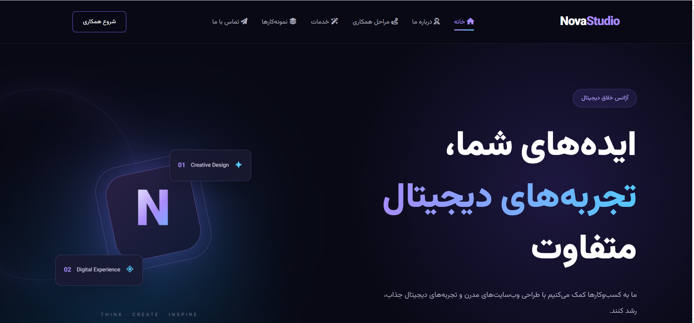
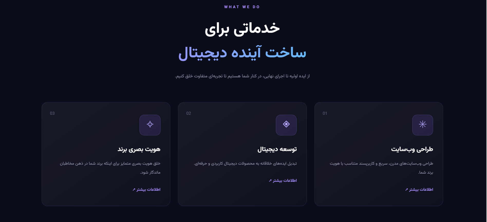
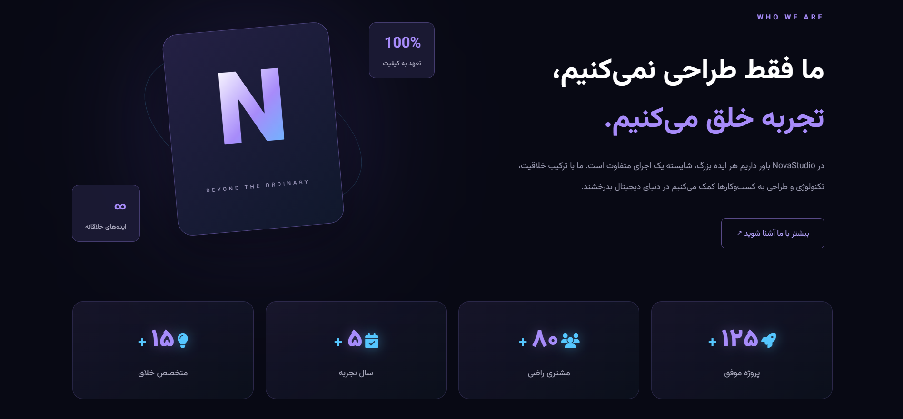
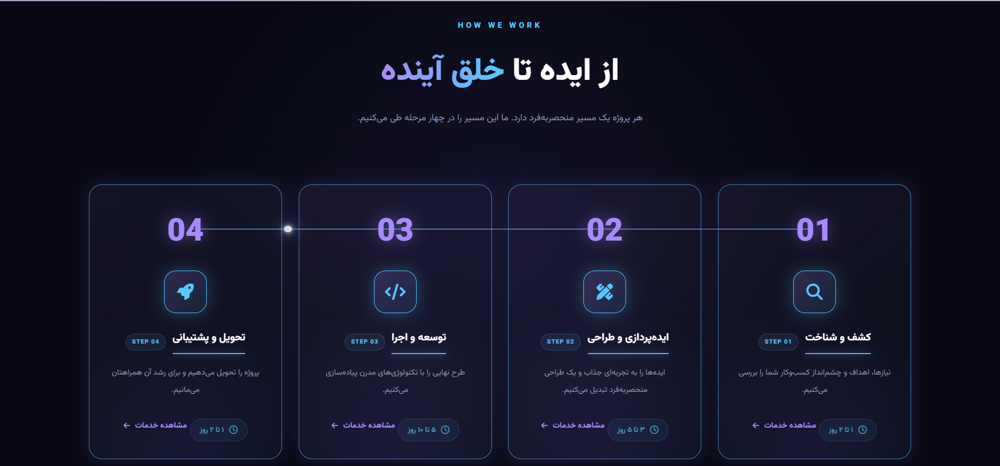
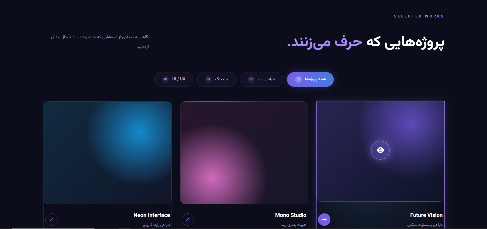
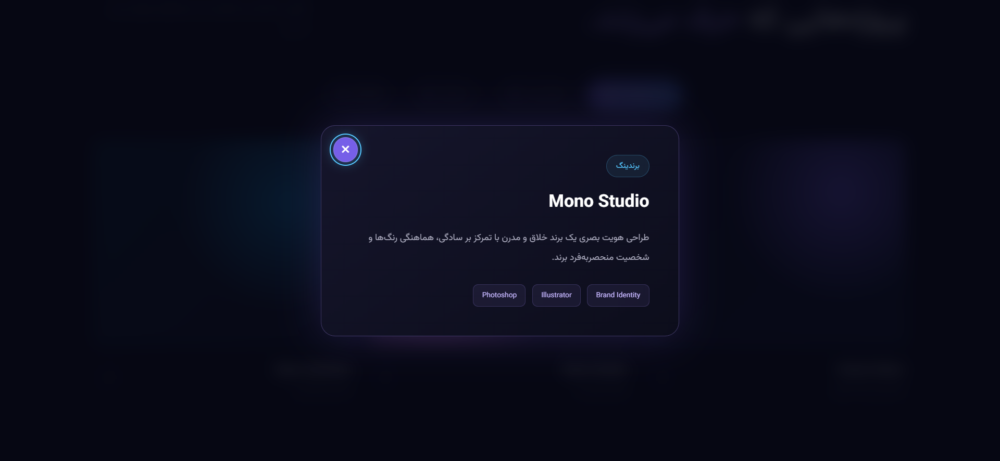
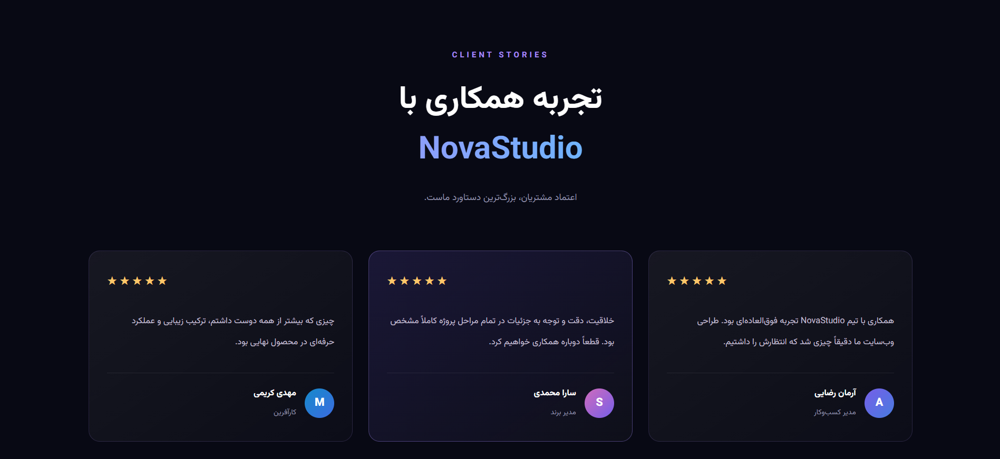
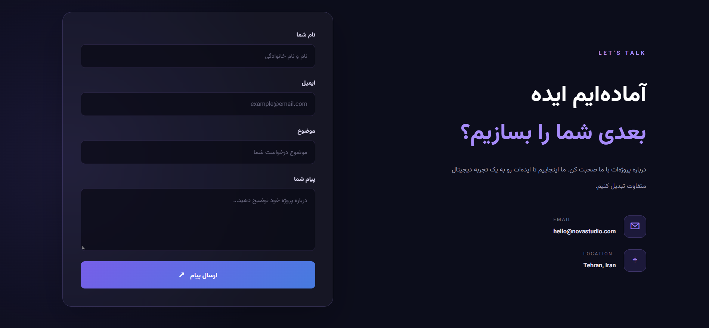

# NovaStudio 🚀

A modern and creative digital agency website built with HTML, CSS, and JavaScript.

## 🌐 Live Demo

[Visit NovaStudio](https://pouya194.github.io/NovaStudio/)

## ✨ Features

- Modern dark UI design
- Responsive layout for mobile, tablet, and desktop
- Interactive portfolio with category filters
- Project details modal
- Animated sections and visual effects
- Interactive contact form
- Accessible navigation and keyboard interactions

## 🛠️ Technologies

- HTML5
- CSS3
- JavaScript
- Font Awesome
- Google Fonts

## 📱 Responsive Design

Optimized for desktop, tablet, and mobile devices.

## 👨‍💻 Author

Pouya Adineh

[GitHub Profile](https://github.com/pouya194)

## 📸 Screenshots

### Homepage

### Services

### About

### Process

### Portfolio

### Portfolio Project Details

### Testimonials

### Contact

